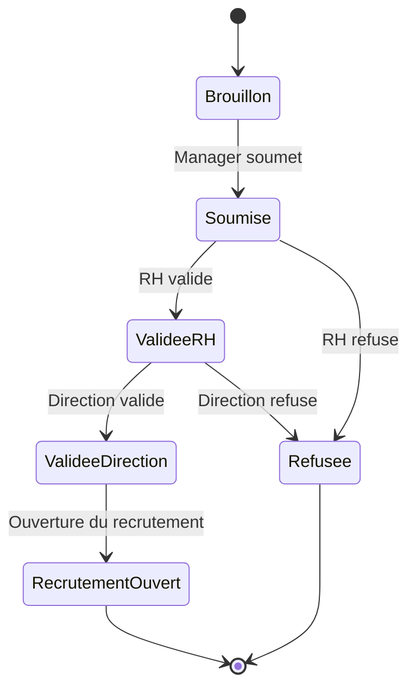
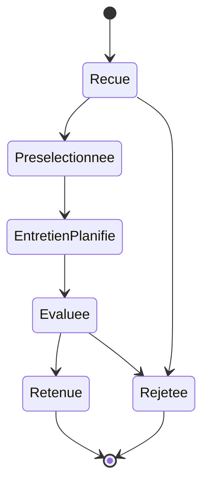
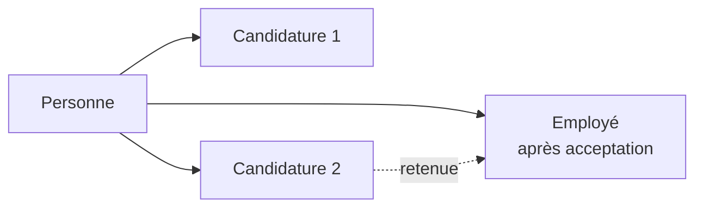
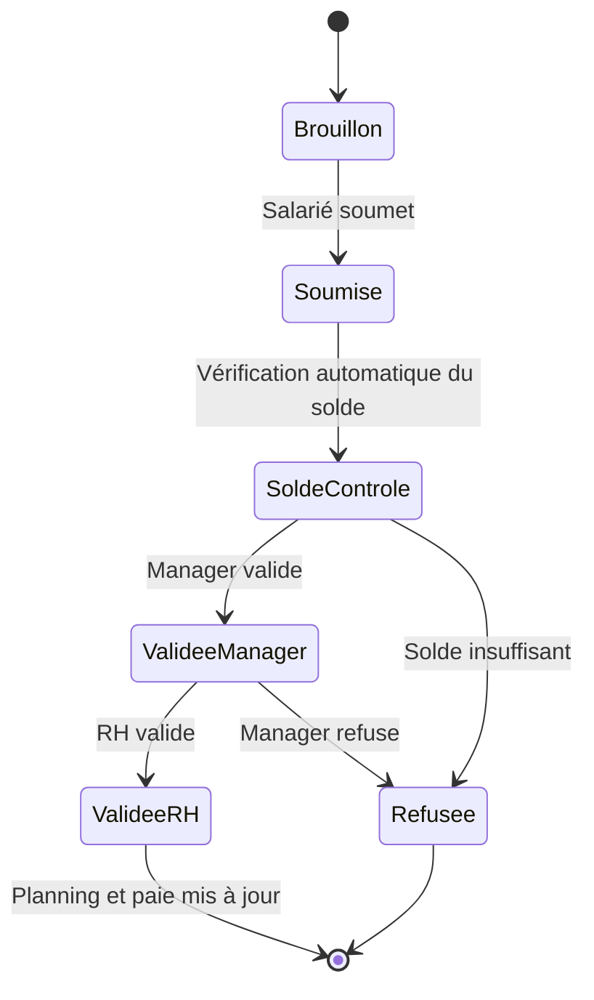
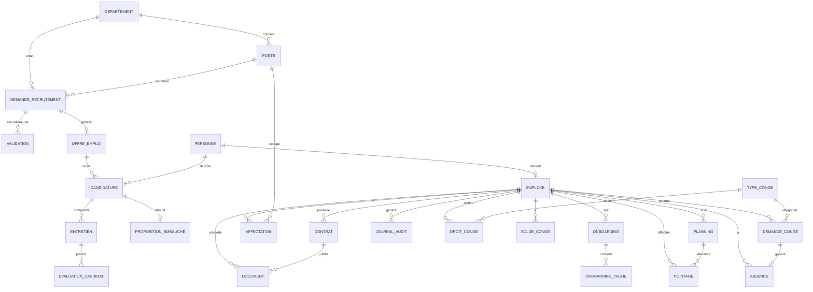
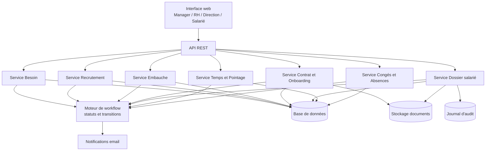

# Conception d'un SIRH (Système d'Information des Ressources Humaines)

> Document de conception basé sur le cours *Conception logiciel – Gestion RH*.
> Les blocs 1 à 4 reprennent les slides du cours. La section « Extensions » propose une suite pour couvrir tout le cycle de vie du salarié (à adapter selon la suite du cours).

---

## 1. Objectifs

- Comprendre les processus RH **avant** de concevoir les fonctionnalités.
- Transformer un processus métier en **règles de gestion, données, workflows et interfaces**.
- Concevoir un SIRH couvrant **tout le cycle de vie du salarié**.
- Éviter une conception limitée à de simples écrans CRUD.
- Faire évoluer un même cas pratique jusqu'à **l'architecture et au MVP**.

## 2. Acteurs

| Acteur | Rôle dans le système |
|---|---|
| Manager | Exprime un besoin en personnel, participe aux entretiens |
| RH | Valide, publie les offres, gère candidatures, contrats, onboarding |
| Direction | Valide l'ouverture du recrutement |
| Candidat | Postule, passe entretiens et tests, accepte ou refuse la proposition |
| Salarié | Titulaire d'un dossier, de contrats et d'affectations |
| Services support (IT, paie, formation, moyens généraux) | Exécutent les tâches d'onboarding |

## 3. Vue d'ensemble du cycle de vie


---

## 4. Bloc 1 — Expression du besoin en personnel

### Description
Un manager exprime un besoin : **création** ou **remplacement** d'un poste.

### Informations saisies
Poste, département, effectif, motif, budget, date souhaitée.

### Workflow

**Manager → RH → Direction → ouverture du recrutement.**

### Objets métier
`Département`, `Poste`, `DemandeRecrutement`, `Validation`.

### Règles de gestion
- **RG1-01** : une demande est créée par un manager, rattachée à un département.
- **RG1-02** : le motif est obligatoire (`CREATION` ou `REMPLACEMENT`).
- **RG1-03** : un remplacement référence le poste concerné.
- **RG1-04** : le budget et la date souhaitée sont obligatoires.
- **RG1-05** : la demande suit les validations dans l'ordre RH puis Direction.
- **RG1-06** : chaque décision est tracée (qui, quand, commentaire) dans `Validation`.
- **RG1-07** : une demande refusée ou validée n'est plus modifiable.

### Point de conception
> Un **POSTE** existe indépendamment de l'**EMPLOYÉ** : un poste peut être vacant, et un employé peut changer de poste. On ne stocke donc pas le poste comme simple attribut de l'employé.

### Interfaces
- Formulaire de demande (manager)
- Liste des demandes à valider (RH, Direction) avec actions valider / refuser
- Suivi de l'état d'une demande

---

## 5. Bloc 2 — Recrutement

### Description
- Transformer une demande validée en **offre d'emploi**.
- Publier l'offre et recevoir **plusieurs candidatures**.
- Présélectionner, organiser les **entretiens** et les **tests**.
- Conserver les **évaluations** et la **décision finale**.

### Objets métier
`OffreEmploi`, `Candidat`, `Candidature`, `Entretien`, `ÉvaluationCandidat`.

### Workflow d'une candidature


### Règles de gestion
- **RG2-01** : une offre est créée uniquement à partir d'une demande validée.
- **RG2-02** : une offre a un statut (`BROUILLON`, `PUBLIEE`, `CLOTUREE`).
- **RG2-03** : une offre reçoit plusieurs candidatures.
- **RG2-04** : un candidat ne peut postuler qu'une fois à la même offre.
- **RG2-05** : une candidature peut avoir plusieurs entretiens (RH, technique, test…).
- **RG2-06** : chaque entretien produit une ou plusieurs évaluations (note, commentaire, avis).
- **RG2-07** : la décision finale est conservée avec son historique.
- **RG2-08** : le recrutement est clôturé quand l'effectif demandé est atteint.

### Interfaces
- Création et publication d'offre
- Liste des candidatures par offre avec filtres par statut
- Planning des entretiens
- Fiche d'évaluation

---

## 6. Bloc 3 — Sélection et embauche

### Description
- Le candidat retenu reçoit une **proposition d'embauche**.
- Après acceptation : création du **dossier salarié** et du **matricule**.
- Création du **contrat**, du **poste** (affectation) et de l'**affectation**.

### Règles de gestion
- **RG3-01** : une proposition d'embauche est liée à une candidature retenue.
- **RG3-02** : statuts de la proposition : `ENVOYEE`, `ACCEPTEE`, `REFUSEE`, `EXPIREE`.
- **RG3-03** : l'acceptation déclenche la création du `Employé` avec un **matricule unique**.
- **RG3-04** : les données du candidat sont reprises dans le dossier salarié, sans supprimer le candidat.
- **RG3-05** : le contrat et l'affectation sont créés à la suite de l'embauche.

### Point de conception
> **CANDIDAT ≠ EMPLOYÉ.** Une personne peut avoir **plusieurs candidatures** avant de devenir salariée. On modélise donc une entité `Personne` (identité) qui peut être liée à des `Candidature` et, éventuellement, à un `Employé`.



---

## 7. Bloc 4 — Contrat et onboarding

### Description
- Un salarié peut avoir **plusieurs contrats successifs** : CDD, renouvellement, CDI…
- **Ne pas écraser l'historique** en stockant seulement `employe.type_contrat`.
- Onboarding : contrat signé, badge, compte, matériel, formation, inscription paie.
- Utiliser une **checklist** et un **workflow d'intégration**.

### Objets métier
`Contrat`, `Affectation`, `Onboarding`, `OnboardingTâche`, `Document`.

### Règles de gestion
- **RG4-01** : un employé a 0..n contrats, chacun avec type, date de début, date de fin, salaire et statut.
- **RG4-02** : un seul contrat actif à la fois par employé (pas de chevauchement de périodes).
- **RG4-03** : un renouvellement crée un **nouveau contrat** lié au précédent.
- **RG4-04** : une affectation relie un employé à un poste avec une période de validité.
- **RG4-05** : un onboarding est créé automatiquement à l'embauche et contient une liste de tâches.
- **RG4-06** : chaque tâche a un responsable, une échéance et un statut (`A_FAIRE`, `EN_COURS`, `FAIT`).
- **RG4-07** : l'onboarding est terminé quand toutes les tâches obligatoires sont faites.
- **RG4-08** : les documents (contrat signé, pièces justificatives) sont rattachés à l'employé ou au contrat.

### Checklist d'onboarding type

| Tâche | Responsable |
|---|---|
| Contrat signé | RH |
| Badge d'accès | Moyens généraux |
| Compte informatique et messagerie | IT |
| Matériel (poste, téléphone…) | IT |
| Formation d'intégration | RH / Manager |
| Inscription à la paie | RH / Paie |

---

## 8. Bloc 5 — Dossier administratif du salarié

### Description
Le dossier salarié devient le **référentiel central du SIRH** : tous les autres blocs (Temps, Congés, Paie) s'y rattachent sans dupliquer ses données.

### Objectifs
- Centraliser **identité, coordonnées, documents et situation professionnelle**.
- Conserver **contrats, affectations, salaire et historique de carrière**.
- Gérer les **documents administratifs et leur validité**.
- Prévoir **confidentialité, habilitations et journal d'audit**.

### Objets métier
`Employe`, `Document`, `Contrat`, `Affectation`, `JournalAudit`.

### Contenu du dossier

| Rubrique | Contenu |
|---|---|
| **Identité & coordonnées** | État civil, adresse, téléphone, e-mail, matricule |
| **Situation professionnelle** | Poste, rattachement, statut, manager |
| **Contrats & affectations** | Historique complet (repris du Bloc 4) |
| **Salaire** | Salaire actuel et historique des évolutions |
| **Historique de carrière** | Changements de poste, d'affectation, de salaire |
| **Documents** | Pièces administratives, avec date de validité |

### Règles de gestion
- **RG5-01** : chaque document a un type, une date de dépôt et une date de validité.
- **RG5-02** : les documents expirés ou proches de l'expiration déclenchent une alerte.
- **RG5-03** : les habilitations définissent qui peut consulter ou modifier quelle rubrique.
- **RG5-04** : toute consultation ou modification sensible est enregistrée dans le journal d'audit (qui, quand, quoi).

### Point de conception
> Le dossier salarié est le **référentiel central** : les blocs Temps de travail, Congés et Paie s'y rattachent, ils ne dupliquent pas ses données.

---

## 9. Bloc 6 — Temps de travail et pointage

### Description
- Définir **horaires, planning et régime de travail**.
- Enregistrer **entrées, sorties, retards et heures supplémentaires**.
- Calculer le **temps réellement travaillé**.
- Détecter les **anomalies de pointage**.
- Les données de temps **alimentent les absences et les variables de paie**.

### Objets métier
`Horaire`, `Planning`, `RegimeTravail`, `Pointage`, `AnomaliePointage`.

### Flux
```
Horaires / planning → Pointage (entrées, sorties) → Calcul du temps réel → Détection d'anomalies
                                                                         → Absences + Variables de paie
```

### Règles de gestion
- **RG6-01** : chaque employé a un régime de travail et un planning associé.
- **RG6-02** : chaque pointage enregistre l'employé, la direction (entrée/sortie), l'horodatage et l'origine (badge, appli…).
- **RG6-03** : le temps réel est calculé par différence entrée/sortie, comparé au planning.
- **RG6-04** : une anomalie est générée en cas d'entrée sans sortie, de pointage hors planning, ou de retard/HS non justifié.
- **RG6-05** : les données de temps sont transmises au Bloc 7 (absences) et aux variables de paie.

---

## 10. Bloc 7 — Congés et absences

### Description
- Workflow : **Demande de congé → Contrôle du solde → Validation manager/RH**.
- Gérer droits, soldes, types de congés, absences et justificatifs.
- Contrôler les **chevauchements** et la **disponibilité du solde**.
- Mettre à jour **planning et variables de paie** après validation.

### Objets métier
`TypeConge`, `DroitConge`, `SoldeConge`, `DemandeConge`, `Absence`.

### Workflow


### Règles de gestion
- **RG7-01** : chaque salarié a un solde par type de congé (congé annuel, RTT, maladie…).
- **RG7-02** : une demande est refusée automatiquement si le solde est insuffisant.
- **RG7-03** : deux congés ne peuvent pas se chevaucher pour le même salarié.
- **RG7-04** : toute absence non planifiée doit être justifiée (arrêt maladie, justificatif…).
- **RG7-05** : après validation, le planning est mis à jour et les variables de paie sont alimentées.

---

## 8. Modèle de données



### Entités principales

| Entité | Attributs clés |
|---|---|
| `Département` | id, nom, responsable_id, parent_id |
| `Poste` | id, intitulé, département_id, description, niveau, statut (vacant / pourvu) |
| `DemandeRecrutement` | id, poste_id, département_id, demandeur_id, motif, effectif, budget, date_souhaitée, statut |
| `Validation` | id, demande_id, étape (RH / Direction), validateur_id, décision, commentaire, date |
| `OffreEmploi` | id, demande_id, titre, description, date_publication, date_clôture, statut |
| `Personne` | id, nom, prénom, date_naissance, email, téléphone |
| `Candidat` / `Candidature` | id, personne_id, offre_id, date_dépôt, statut, CV |
| `Entretien` | id, candidature_id, type, date, intervenants, lieu |
| `ÉvaluationCandidat` | id, entretien_id, évaluateur_id, note, commentaire, avis |
| `PropositionEmbauche` | id, candidature_id, date_envoi, salaire_proposé, statut |
| `Employé` | id, matricule, personne_id, date_embauche, statut |
| `Contrat` | id, employé_id, type (CDD / CDI…), date_début, date_fin, salaire, contrat_précédent_id, statut |
| `Affectation` | id, employé_id, poste_id, date_début, date_fin |
| `Onboarding` | id, employé_id, date_début, statut |
| `OnboardingTâche` | id, onboarding_id, libellé, responsable_id, échéance, statut, obligatoire |
| `Document` | id, type, fichier, employé_id, contrat_id, date_dépôt, date_validité |
| `JournalAudit` | id, employé_id, acteur_id, action, table_cible, date, détail |
| `Horaire` | id, libellé, heure_début, heure_fin, pause |
| `RegimeTravail` | id, libellé, nb_heures_semaine |
| `Planning` | id, employé_id, semaine, horaire_id |
| `Pointage` | id, employé_id, direction (ENTREE/SORTIE), horodatage, origine, planning_id |
| `AnomaliePointage` | id, pointage_id, type, description, statut |
| `TypeConge` | id, code, libellé, plafonné, duree_max |
| `DroitConge` | id, employé_id, type_conge_id, année, jours_acquis |
| `SoldeConge` | id, employé_id, type_conge_id, solde_actuel |
| `DemandeConge` | id, employé_id, type_conge_id, date_début, date_fin, statut, commentaire |
| `Absence` | id, employé_id, date_début, date_fin, type, justificatif |

---

## 9. Workflows transverses

1. **Besoin** : Brouillon → Soumise → Validée RH → Validée Direction → Recrutement ouvert.
2. **Recrutement** : Offre publiée → Candidatures → Présélection → Entretiens/tests → Décision.
3. **Embauche** : Proposition → Acceptation → Création employé + matricule + contrat + affectation.
4. **Intégration** : Création de l'onboarding → Tâches par service → Clôture.
5. **Dossier** : Référentiel central alimenté par tous les blocs ; accès soumis à habilitations ; journal d'audit.
6. **Temps** : Planning → Pointage → Calcul temps réel → Anomalies → Variables de paie.
7. **Congés** : Demande → Contrôle solde → Validation manager/RH → Mise à jour planning + paie.

Chaque transition doit enregistrer : **acteur, date, commentaire** (traçabilité).

## 10. Droits d'accès (rôles)

| Fonction | Manager | RH | Direction | Salarié |
|---|:-:|:-:|:-:|:-:|
| Créer une demande de recrutement | ✅ | ✅ | | |
| Valider une demande | | ✅ | ✅ | |
| Gérer offres et candidatures | | ✅ | | |
| Participer aux entretiens / évaluer | ✅ | ✅ | | |
| Créer contrat et dossier salarié | | ✅ | | |
| Gérer l'onboarding | | ✅ | | |
| Consulter le dossier salarié complet | | ✅ | | |
| Voir son propre dossier | | | | ✅ |
| Valider les congés | ✅ | ✅ | | |
| Consulter le journal d'audit | | ✅ | ✅ | |
| Gérer le pointage | | ✅ | | |

> Les données RH (salaire, évaluations, documents sensibles) sont soumises à habilitations ; toute consultation ou modification est journalisée (journal d'audit).

## 11. Architecture proposée



Principes :
- Une couche **domaine** portant les règles de gestion (pas de logique dans les écrans).
- Les statuts et transitions sont explicites (machine à états).
- Historisation plutôt qu'écrasement (contrats, affectations, validations, soldes congés).
- Le dossier salarié est le **référentiel central** : les autres services le consultent, ne le dupliquent pas.

## 12. Périmètre du MVP

| Priorité | Fonctionnalité |
|---|---|
| Must | Demande de recrutement + validation Manager → RH → Direction |
| Must | Offre d'emploi, candidatures, statuts de candidature |
| Must | Proposition d'embauche et création du dossier salarié + matricule |
| Must | Contrats successifs avec historique |
| Must | Dossier administratif du salarié (Bloc 5) — référentiel central |
| Should | Entretiens et évaluations |
| Should | Checklist d'onboarding |
| Should | Temps de travail et pointage (Bloc 6) |
| Should | Congés et absences (Bloc 7) |
| Could | Documents, notifications email, tableaux de bord |
| Could | Journal d'audit complet |

## 13. Extensions possibles (à confirmer avec la suite du cours)

Pour couvrir « tout le cycle de vie du salarié » :
- **Paie** : éléments variables, export vers la paie (alimentée par Blocs 6 et 7).
- **Formation et compétences** : plan de formation, habilitations.
- **Évaluation de performance** : entretiens annuels, objectifs.
- **Mobilité et carrière** : changement de poste, promotion.
- **Sortie** : démission, fin de contrat, solde de tout compte, offboarding.

## 14. Points de vigilance de conception (résumé)

| Piège à éviter | Bonne pratique |
|---|---|
| Poste = attribut de l'employé | `Poste` indépendant, lié par `Affectation` |
| Candidat = Employé | `Personne` + `Candidature` + `Employé` |
| `employe.type_contrat` unique | Table `Contrat` avec historique |
| Écrans CRUD sans logique | Workflows, statuts, règles de gestion |
| Onboarding informel | `Onboarding` + `OnboardingTâche` avec checklist |
| Dossier salarié fragmenté | Référentiel central unique, accès par habilitations |
| Pointage sans contrôle | Comparaison planning/pointage, détection d'anomalies |
| Congé sans solde ni validation | Workflow complet : contrôle solde → manager → RH |
